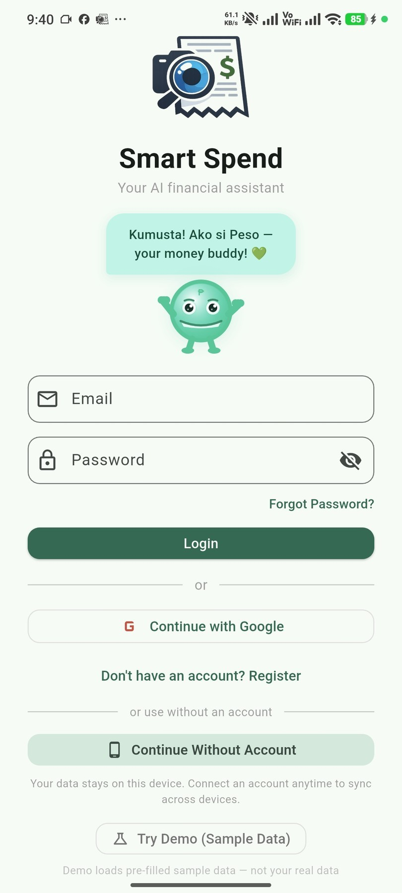
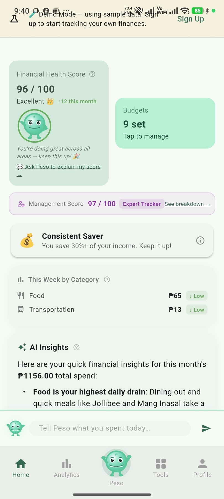
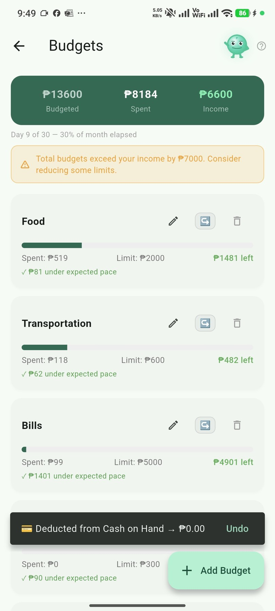
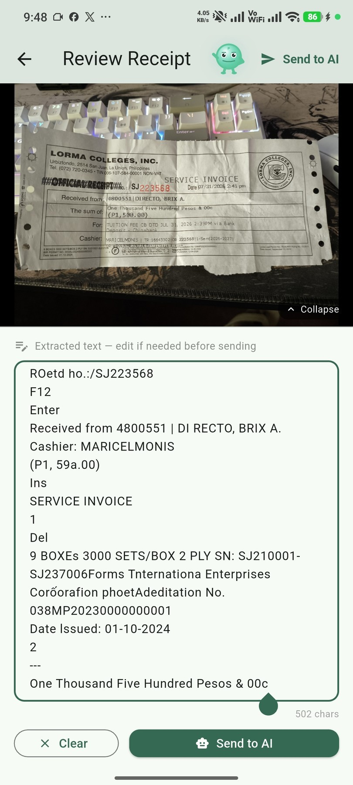
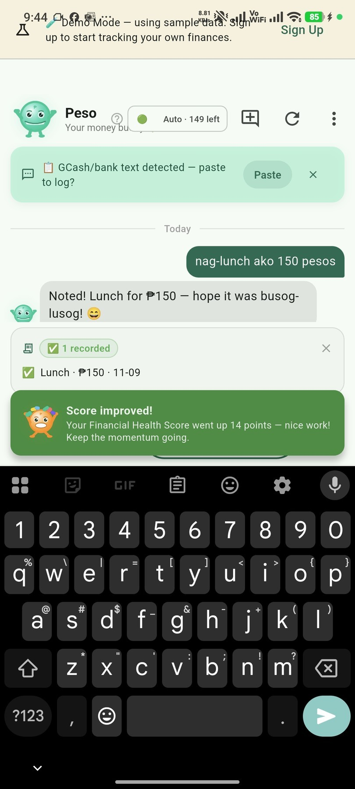
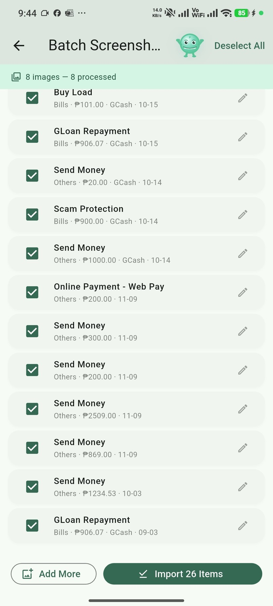
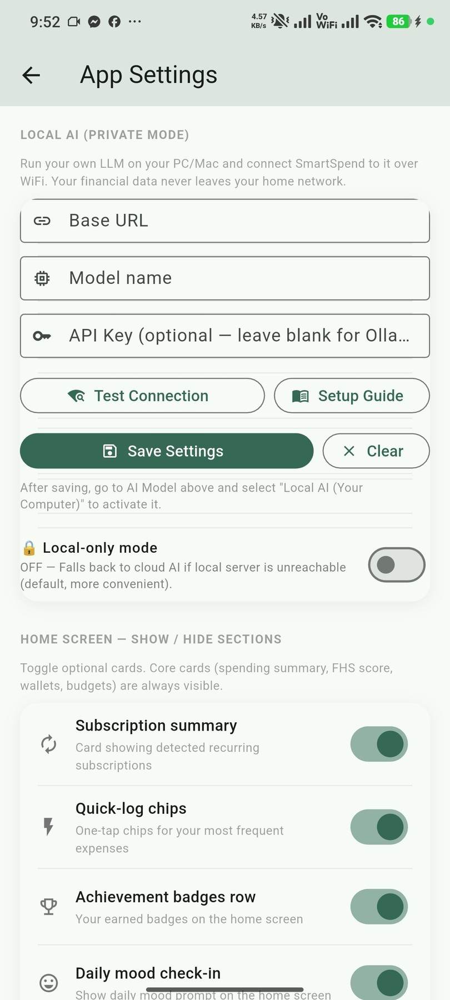

# SmartSpend

**AI-Assisted Financial Tracking & Advisory for Filipinos**  
Version 3.2.0 | Lucid Frame | Academic Year 2026–2027, 1st Semester

[](https://github.com/Zushikina-kun/smartspend-app/releases/latest)
[](https://zushikina-kun.github.io/smartspend-app/)

> **Note on screenshots and demo:** The website screenshots were taken during development (v3.0.4) and the interactive demo shows a simplified prototype of the general concept. The actual app has been significantly updated since — animations, Peso mascot interactions, UI polish, and features have all been improved. Download the latest APK for the full experience.

---

## Support the Project

SmartSpend is free right now. Source Available License (Non-Commercial) — see LICENSE. If it helped you, consider supporting the dev:

| Platform | Link |
|----------|------|
| ☕ Buy Me a Coffee | https://buymeacoffee.com/zushikina_kuroh143 |
| 🍵 Ko-fi | https://ko-fi.com/zushikina143 |
| 🅿️ PayPal | https://paypal.me/BrixDirecto |

---

## About

SmartSpend is a free AI-powered personal finance tracker for Android, built for everyday Filipino users. It helps you record, analyze, and manage your spending with minimal effort — using voice, camera, or just typing naturally in Taglish or English.

The app is actively developed and regularly updated. Features, UI, and Peso mascot interactions evolve with each release.

**✨ What's New in v3.2.0:**
- 🏛️ **Government Contributions Tracker** — First Filipino finance app to track SSS, PhilHealth, and Pag-IBIG contributions with year-to-date totals and SSS pension estimator
- 📱 **Improved Accessibility** — Fixed scrolling issues in AI model selector for devices under 5.5"
- 🔗 **Direct Portal Links** — Quick access to sss.gov.ph, philhealth.gov.ph, and pagibigfund.gov.ph from within the app

[View Full Changelog](CHANGELOG.md)

**Developed by Lucid Frame:**
- Brix A. Directo — Lead Developer
- Cyrille John M. Rubis — UI/UX Designer & Documentation Lead
- Djaunathan Albert S. Madayag — Project Manager & QA Lead

**Adviser:** Dr. Janelli M. Raposas — Lorma Colleges, College of Computer Studies and Engineering (CCSE)

**Defense Date:** November 10, 2026

---

## Screenshots

<p align="center">
  
  
  
</p>

<p align="center">
  
  
  
  
</p>

*App screenshots from v3.1.1 (October 2026). See [docs/images/screenshots/](docs/images/screenshots/) for full resolution.*

---

## Meet Peso 🤖

Peso is SmartSpend's AI mascot — a friendly ₱ peso coin character who guides you through the app, celebrates your financial wins, and nudges you gently when something needs attention.

- **Appears on 45 screens** — from login to analytics to achievements
- **Reacts to your data** — proud when FHS is high, worried when budget is tight, celebrating when you hit goals
- **Speaks in Taglish** — warm, non-judgmental, always helpful
- **Tappable** — tap Peso anywhere for a bounce + mood reaction
- **All ❓ info buttons** show Peso explaining the feature instead of a plain dialog
- **AI chat** — every reply shows Peso's avatar; he changes mood based on what he's saying

---

## Features

### Core Tracking
- 🎙️ **7 Input Methods** — Voice, OCR receipt scan, barcode, manual entry, batch screenshots (40+ platforms), bank CSV paste, natural language chat
- 🤖 **Peso AI** — **34 agentic action types** via natural language in Taglish or English (Gemini 3.5 Flash-Lite primary, **9-provider** auto-fallback chain)
- 📱 **Use Without Account** — start immediately, no sign-up required; data stays on device
- 🔒 **Local AI Mode** — connect to Ollama, LM Studio, or Jan on your PC; zero cloud exposure

### Financial Intelligence
- 🧠 **Financial Health Score (FHS)** — 0–100 score across 4 pillars: Savings Rate, Overspend Control, Budget Adherence, Logging Consistency
- 💚 **Safe to Spend** — how much you can freely spend before payday after bills and goals
- 📊 **Analytics** — pie chart, trend bars, 50/30/20 rule, savings rate, FHS history, spending heatmap, long-range forecast (3/6/12 months), AI financial advice
- 💹 **Peso Cost Averaging Calculator** — MP2, UITFs, stocks with year-by-year projections

### Filipino-Specific Features
- 💳 **Installment Plans** — ShopeePayLater, GCash GLoan, HomeCredit, any fixed monthly payment
- 🏛️ **Government Contributions Tracker** ⭐ NEW in v3.2.0
  - Track SSS, PhilHealth, and Pag-IBIG contributions year-to-date
  - SSS pension estimator calculator
  - Dashboard integration with auto-hiding total expenses widget
  - Direct links to official government portals
  - Year selector for viewing historical contribution data
- 🏦 **PH Banks Database** — 20 banks, 5 digital banks, e-wallets, investment options comparison
- 🏅 **Paluwagan Tracker** — rotating savings group management
- 💱 **57 currencies** with live exchange rates

### Gamification & Engagement
- 🏆 **36 Achievement Badges** — earn badges for financial milestones, streaks, Peso interactions
- 📅 **Daily Quests** — 10 rotating quests with streak tracking
- 😊 **Daily Mood Check-In** with spending correlation analysis
- 🎉 **Peso Milestone Celebrations** — 25/50/75/100% goal progress, expense count milestones, streak milestones

### Peso Companion (v3.0.5+)
- 💬 **Daily Nudges** — gentle check-in if no expenses logged by 2PM, budget status reactions
- 🎯 **Goal Celebrations** — Peso appears at each milestone with mood-matched message
- 🏅 **Badge Celebrations** — Peso bottom sheet on every badge unlock
- 🔔 **Smart Reactions** — first-log-of-day, no-spend day, budget warnings, FHS tier changes

### Other
- ⚙️ **Full App Settings** — dark/light mode, 12 color themes, compact mode, Local AI config
- 🔐 **API Security** — Firebase Remote Config + App Check
- ☁️ **Full Firestore sync** across devices (optional)
- 🔒 **App Lock** — PIN + biometric
- 🗓️ **Financial Calendar** — bills, goals, debts all in one view
- 🏅 **Financial Health Certificate** — shareable monthly score card
- 📖 **Financial Glossary** — 23 key terms in plain Filipino-English
- 💬 **In-App Feedback** — submit bug reports and feature requests directly to GitHub Issues

---

## Tech Stack

| Component | Technology |
|-----------|-----------|
| Framework | Flutter (Dart) |
| AI Engine | Multi-model LLM with **9-provider** auto-failover — Gemini 3.5 Flash-Lite (primary), Gemini 3.5 Flash, GPT-OSS 120B (Groq), Qwen3.6/3.8 27B, Compound Mini, GPT-OSS 120B (Cerebras), Custom Local LLM — **34 agentic actions** |
| Local DB | SQLite via sqflite (v14 schema, 26 tables) |
| Cloud | Firebase Auth + Firestore + Remote Config + Crashlytics + App Check |
| OCR | Google ML Kit Text Recognition |
| Barcode | Google ML Kit Barcode Scanning + MobileScanner |
| Charts | fl_chart |
| Mascot | Custom `CustomPainter`-based animated widget — 12 moods, idle animation, eye blink, mood pop-in |
| Backup | System share sheet (JSON, v9 format) |
| App Lock | local_auth (PIN + biometric) |
| Exchange Rates | open.er-api.com |

**Architecture:** Serverless/client-side only. No backend server. All logic runs on-device + Firebase + third-party APIs. Zero hosting costs.

---

## Research & Evaluation

SmartSpend is a capstone research project at Lorma Colleges (AY 2026-2027, 1st Semester). 

**Defense:** November 10, 2026

**Final Evaluation Results:**
- **System Usability Scale (SUS):** 61.83 (SD 17.58), Grade D, adjective "OK"
- **Respondents:** N=30 (parents n=10, young professionals n=20)
- **Score Range:** 35.0–92.5
- **Interpretation:** Below the 68.0 benchmark; acknowledged as a prototype limitation
- **Supporting Data:** 96.7% want AI financial app, 93.3% use GCash

Data collection for the formal evaluation is complete. Thank you to all respondents!

---

## Version History

| Version | Highlights |
|---------|-----------|
| **3.2.0** | 🆕 Government contributions tracker (SSS/PhilHealth/Pag-IBIG) with YTD totals, pension estimator, portal links; scrolling fixes for small screens |
| **3.1.2** | UX polish — clearSnackBars, FHS tier ring, setup CTA, quick input bar prominence, weekly notification fix |
| **3.1.1** | Peso gestures (double-tap, long-press, idle timer), AI transaction save fix, site factual corrections |
| **3.1.0** | FHS tier change announcements, streak milestones, notification tap reaction, session tips |
| **3.0.9** | Swipe-to-delete, Quick Undo, profile section headers, PesoContextService on 6 screens |
| **3.0.8** | All notifications Peso-voiced, PesoContextService (17 screens), smart nav tap logic |
| **3.0.7** | Peso on 45 screens, nav AI button is Peso, chat bubbles show Peso avatar, typing indicator |
| **3.0.6** | Peso companion system — daily nudges, goal celebrations, 36 badges, PesoVoice, tappable Peso |
| **3.0.5** | Peso animation (12 moods), feedback screen, privacy disclosure, Quick Tips |
| **3.0.4** | Local-only AI mode, login warning, use-without-account |
| **3.0.0** | Paluwagan, Insurance tracker, PH Banks guide, Achievements, Daily Quests |

---

## How to Run

Quick start:
```bash
flutter pub get
flutter run
```

---

## Build

```bash
flutter build apk --release --split-per-abi --shrink --obfuscate --split-debug-info=build/debug-info
```

**CI/CD — Automated Release Pipeline:**
```bash
git tag v3.0.X && git push origin v3.0.X
# GitHub Actions auto-builds and publishes signed APKs to Releases
```

---

## Configuration

| File | Purpose |
|------|---------|
| `android/app/google-services.json` | Firebase config (not in repo) |
| `lib/services/app_config.dart` | API keys — in `.gitignore`, copy from `app_config.dart.example` |

---

## Documentation

| File | Contents |
|------|---------|
| `docs/reference/brand-assets-reference.md` | Brand colors, Peso design guide, logo rules |
| `docs/reference/CAPSTONE_REFERENCE.md` | Single source of truth for capstone numbers |
| `docs/guides/DEFENSE_GUIDE.md` | Pre-defense quick reference — FHS formula, demo script, Q&A |
| `docs/reference/BENCHMARK.md` | 22-app comparison + LLM benchmark |
| `docs/handsoff/kiro-to-kiro-handoff-2026-10-12-final.md` | Full session record — all features built |
| `docs/handsoff/remaining-tasks-2026-10-12.md` | Remaining tasks with estimates |
| `docs/status/PROJECT_STATUS.md` | What's done, what's left, roadmap |

---

*Smart Spend — Spend Smart, Live Better.*  
*© 2026 Lucid Frame. Capstone Research Project — Lorma Colleges CCSE.*  
*Not affiliated with any financial institution.*


---

## 🎓 Defense Materials (November 2026)

### Final Thesis Defense
**Date**: November 10, 2026  
**Status**: ✅ **100% READY**

All defense materials are located in: **`docs/handsoff/FOR_CYRILLE/`**

#### Quick Access
- **Final Manuscript**: `docs/handsoff/FOR_CYRILLE/1_MAIN_MANUSCRIPT_FINAL.docx`
- **Final Presentation**: `docs/handsoff/FOR_CYRILLE/3_PRESENTATION_FINAL.pptx`
- **Defense Script**: `docs/handsoff/FOR_CYRILLE/4_DEFENSE_SCRIPT_FINAL.md`
- **Complete Documentation**: `docs/handsoff/FOR_CYRILLE/00_START_HERE.md`

#### What Was Verified (Nov 9, 2026)
✅ All 8 figures inserted into manuscript  
✅ All SUS numbers updated (61.83, Grade D, N=30)  
✅ 6 critical blockers fixed (demographics, preliminary warnings)  
✅ All documents cross-verified for consistency  
✅ 17/17 automated verification checks passed

See: `docs/handsoff/FOR_CYRILLE/MASTER_CHANGELOG.md` for complete change history

---
