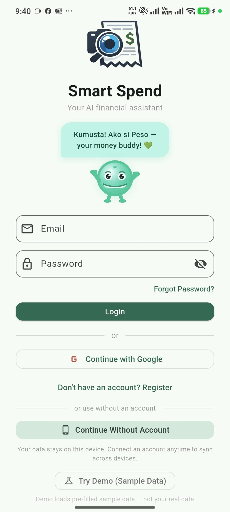
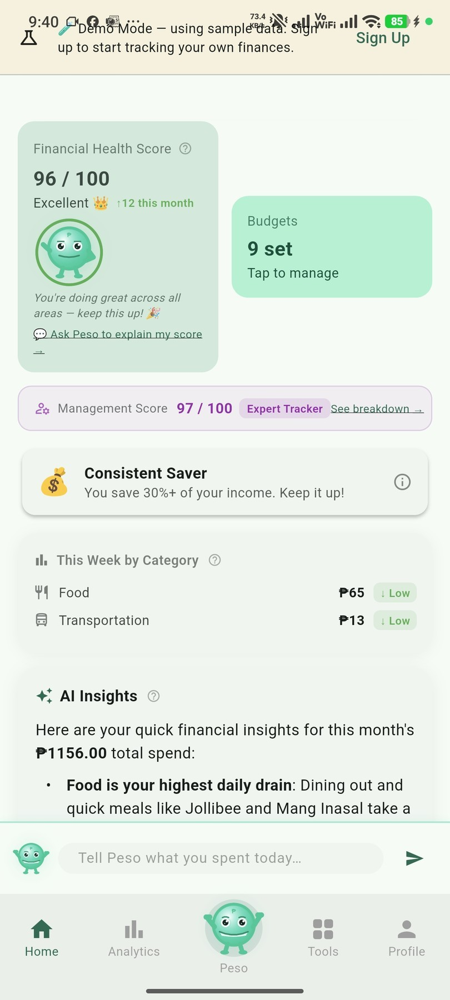
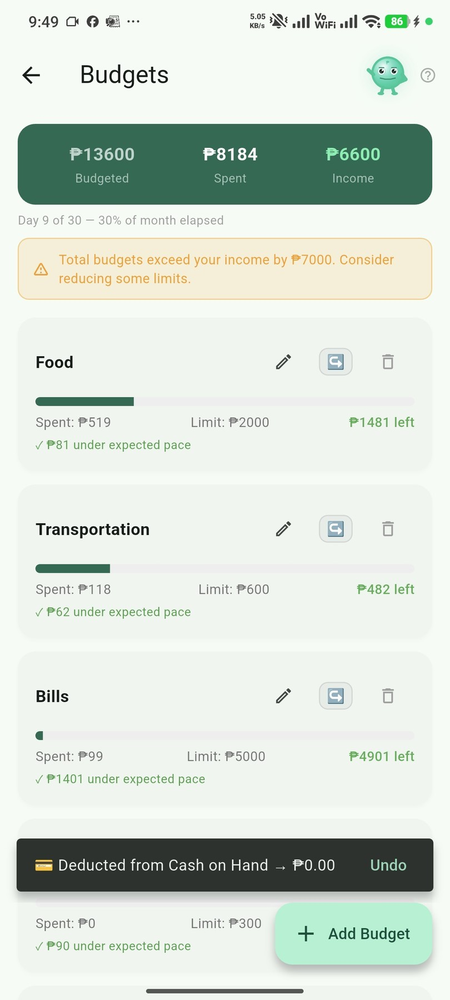
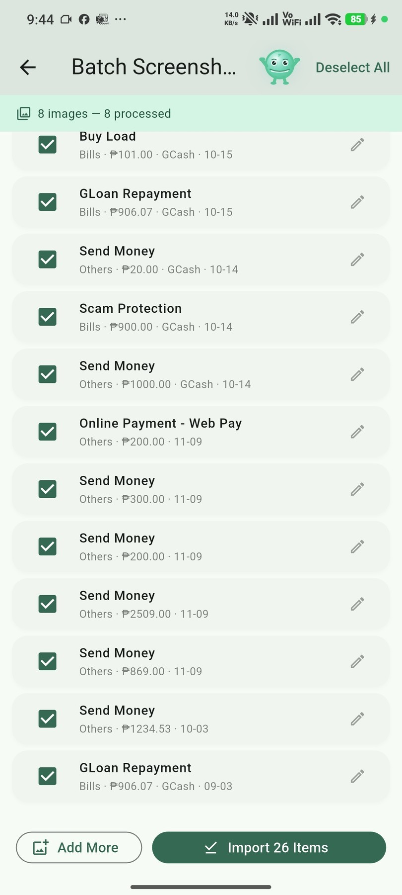

# SmartSpend

**AI-Assisted Financial Tracking & Advisory for Filipinos**  
Version v3.5.2 | Lucid Frame | Academic Year 2026–2027, 1st Semester

[](https://github.com/Zushikina-kun/smartspend-app/releases/latest)
[](https://zushikina-kun.github.io/smartspend-app/)

---

## Support the Project

SmartSpend is free. Source Available License (Non-Commercial) — see LICENSE. If it helped you, consider supporting the dev:

| Platform | Link |
|----------|------|
| ☕ Buy Me a Coffee | https://buymeacoffee.com/zushikina_kuroh143 |
| 🍵 Ko-fi | https://ko-fi.com/zushikina143 |
| 🅿️ PayPal | https://paypal.me/BrixDirecto |

---

## About

SmartSpend is a free AI-powered personal finance tracker for Android, built for everyday Filipino users. It helps you record, analyze, and manage your spending with minimal effort — using voice, camera, or just typing naturally in Taglish or English.

---

## What's New in v3.5.2

- 🤖 **20 AI Models** — full OpenRouter individual model routing with corrected model IDs
- 🔄 **16-model continuous fallback chain** — walks best→worst without stopping; every model in the chain is tried before giving up
- 📋 **BIR Tax Reminders** — quarterly deadlines, income tax estimator, percentage tax calculator, local notifications
- 🏠 **Home Menu Entry** — Tax Calculator accessible from Quick Access Hub
- 👁️ **Vision model priority** — OCR receipt parsing prefers vision-capable models first
- ⚡ **Voice speed routing** — voice commands prefer fast/low-latency models

**Final Defense Date:** November 20, 2026 at 11:00 AM *(completed)*

[View Full Changelog](CHANGELOG.md) | [🌐 Website](https://zushikina-kun.github.io/smartspend-app/)

**Developed by Lucid Frame:**
- Brix A. Directo — Lead Developer
- Cyrille John M. Rubis — UI/UX Designer & Documentation Lead
- Djaunathan Albert S. Madayag — Project Manager & QA Lead

**Adviser:** Dr. Ellen F. Mangaoang, DIT — Lorma Colleges, College of Computer Studies and Engineering (CCSE)

---

## Screenshots

<p align="center">
  
  
  
</p>

<p align="center">
  
  
  
</p>

*Screenshots from v3.1.1 (October 2026). See [docs/images/screenshots/](docs/images/screenshots/) for full resolution.*

---

## Features

### Core Tracking
- 🎙️ **7 Input Methods** — Voice, OCR receipt scan, barcode, manual entry, batch screenshots (40+ platforms), bank CSV paste, natural language chat
- 🤖 **Peso AI** — 34 agentic action types via natural language in Taglish or English with 20 AI models across 5 providers
- 📱 **Use Without Account** — start immediately, no sign-up required; data stays on device
- 🔒 **Local AI Mode** — connect to Ollama, LM Studio, or Jan on your PC; zero cloud exposure

### Financial Intelligence
- 🧠 **Financial Health Score (FHS)** — 0–100 score across 4 pillars: Savings Rate, Overspend Control, Budget Adherence, Logging Consistency
- 💚 **Safe to Spend** — how much you can freely spend before payday after bills and goals
- 📊 **Analytics** — pie chart, trend bars, 50/30/20 rule, savings rate, FHS history, spending heatmap, long-range forecast (3/6/12 months), AI financial advice
- 💹 **Peso Cost Averaging Calculator** — MP2, UITFs, stocks with year-by-year projections
- 📈 **Price Intelligence** — track prices across stores, spot trends, find best deals

### Filipino-Specific Features
- 📋 **BIR Tax Reminders** ⭐ NEW in v3.5.2
  - Quarterly deadlines (Q1 Apr 15, Q2 Aug 15, Q3 Nov 15, Annual ITR Apr 15)
  - Income tax estimator (TRAIN Law — 8% flat rate vs. graduated)
  - Quarterly percentage tax calculator (2551Q — 3% flat rate)
  - Local push notifications 30, 7, and 1 day before each deadline
- 💳 **Installment Plans** — ShopeePayLater, GCash GLoan, HomeCredit, any fixed monthly payment
- 🏛️ **Government Contributions Tracker** — SSS, PhilHealth, Pag-IBIG YTD totals, pension estimator
- 🚗 **LTO Vehicle Renewal** — registration dates, fee calculator, reminders
- 🏦 **PH Banks Database** — 20 banks, 5 digital banks, e-wallets, investment options comparison
- 🏅 **Paluwagan Tracker** — rotating savings group management
- 💱 **57 currencies** with live exchange rates
- 🌏 **OFW Tools** — remittance tracking, Balikbayan box tracker

### Gamification & Engagement
- 🏆 **36 Achievement Badges** — earn badges for financial milestones, streaks, Peso interactions
- 📅 **Daily Quests** — 10 rotating quests with streak tracking
- 😊 **Daily Mood Check-In** with spending correlation analysis
- 🎉 **Peso Milestone Celebrations** — 25/50/75/100% goal progress, expense count milestones, streak milestones

### Peso Companion
- 💬 **Daily Nudges** — gentle check-in if no expenses logged by 2PM, budget status reactions
- 🎯 **Goal Celebrations** — Peso appears at each milestone with mood-matched message
- 🏅 **Badge Celebrations** — Peso bottom sheet on every badge unlock
- 🔔 **Smart Reactions** — first-log-of-day, no-spend day, budget warnings, FHS tier changes

### Other
- ⚙️ **Full App Settings** — dark/light mode, 12 color themes, compact mode, Local AI config
- 🔐 **API Security** — Firebase Remote Config + App Check
- ☁️ **Full Firestore sync** across devices (optional)
- 🔒 **App Lock** — PIN + biometric
- 🗓️ **Financial Calendar** — bills, goals, debts all in one view
- 💬 **In-App Feedback** — submit bug reports and feature requests directly to GitHub Issues

---

## AI Models

SmartSpend integrates **20 AI models** across multiple providers with intelligent auto-fallback. Auto mode walks the full chain best→worst without stopping until a model responds.

### Automatic Fallback Chain

Auto mode walks this chain in order, skipping providers with no key:

```
Nemotron 3 Ultra → Llama 3.3 70B → Gemma 4 31B → Nemotron 3.5 Lightning →
Qwen 3.8 (OR) → Nemotron Nano → Nemotron Super VL → Gemma 4 26B →
Gemini 3.5 Flash → Gemini 3.5 Flash-Lite → Qwen3.6 (Groq) →
Qwen3.8 (Groq) → Compound → Compound Mini → GPT-OSS 120B (Cerebras)
```

### Available Models by Tier

#### Tier 0: Special Modes
| ID | Model | Notes |
|----|-------|-------|
| `auto` | Auto (Recommended) | 🤖 Smart routing — best quality available, auto-fallback |
| `custom_local` | Local AI (Your Computer) | 🏠 Ollama/LM Studio/Jan via WiFi — private, no cloud |

#### Tier 1: Premium Quality (Best Reasoning)
| ID | Model | Vision | Notes |
|----|-------|--------|-------|
| `or_nemotron_ultra` | Nemotron 3 Ultra (OpenRouter) | — | 🏆 550B MoE, 1M ctx, top free model |
| `or_llama33` | Llama 3.3 70B (OpenRouter) | — | 🦙 70B, 128K ctx, 9.4 Intelligence Index |
| `gemini_flash` | Gemini 3.5 Flash | ✅ | 💎 Best Gemini, frontier reasoning, GA stable |
| `gemini_flash_lite` | Gemini 3.5 Flash-Lite ⭐ | ✅ ⚡ | Default — fastest + reliable, GA stable |

#### Tier 2: High Quality (Solid Performance)
| ID | Model | Vision | Fast | Notes |
|----|-------|--------|------|-------|
| `or_gemma_4_31b` | Gemma 4 31B (OpenRouter) | — | — | 💎 262K ctx, well-tested, balanced |
| `or_nemotron_lightning` | Nemotron 3.5 Lightning (OpenRouter) | — | ⚡ | Near-instant responses, 1M ctx |
| `or_qwen38` | Qwen 3.8 27B (OpenRouter) | ✅ | — | 🌐 Multimodal, 128K ctx, OCR |
| `groq_llama4_scout` | GPT-OSS 120B (Groq) | — | — | 🚀 1,000/day, 8K TPM |

#### Tier 3: Good (Reliable Workhorses)
| ID | Model | Vision | Notes |
|----|-------|--------|-------|
| `or_nemotron_super_vl` | Nemotron 3.5 Super VL (OpenRouter) | ✅ | 🎨 1M ctx, image + video |
| `or_gemma_4_26b` | Gemma 4 26B A4B (OpenRouter) | — | ⚙️ MoE 3.8B active, 262K ctx |
| `or_nemotron_nano` | Nemotron Nano 30B (OpenRouter) | — | 🧠 30B MoE, free tier |
| `groq_kimi_k2` | Qwen3.6 27B (Groq) | ✅ | 🌐 Multimodal + reasoning, 1,000/day |
| `groq_qwen3` | Qwen3.8 27B (Groq) | ✅ | ✨ Newer Qwen, multimodal, 1,000/day |

#### Tier 4: Utility (Fast & Available)
| ID | Model | Fast | Notes |
|----|-------|------|-------|
| `groq_70b` | Compound (Groq) | ⚡ | 250/day, 70K TPM — good general |
| `groq_8b` | Compound Mini (Groq) | ⚡ | 250/day, 70K TPM — fast tasks |
| `openrouter` | OpenRouter Gateway (Legacy) | — | Use individual models above |

#### Tier 5: Last Resort (Fallback)
| ID | Model | Fast | Notes |
|----|-------|------|-------|
| `cerebras_120b` | GPT-OSS 120B (Cerebras) | ⚡ | 🔄 1M tokens/day, ~3,000 t/s |

**Vision** (✅): model accepts image input — preferred by OCR receipt parsing.  
**Fast** (⚡): low-latency model — preferred by voice command processing.

### Provider Summary

| Provider | Models | Daily Limit |
|----------|--------|-------------|
| **OpenRouter** | 8 models | 1,000 req/day (shared, with $10 credit) |
| **Gemini** (Google AI Studio) | 2 models | Generous free tier |
| **Groq** | 5 models | 250–1,000 req/day per model |
| **Cerebras** | 1 model | 1M tokens/day |
| **Custom Local** | Unlimited | No limits (your hardware) |

### 34 Agentic Actions

All models support SmartSpend's 34 agentic actions via tool calling:
- Add/edit/delete expenses, budgets, savings goals, debts, bills
- Financial Health Score analysis
- Budget recommendations, spending insights & trends
- Safe-to-spend calculations, category suggestions
- Receipt parsing & batch screenshot analysis
- And more...

---

## Tech Stack

| Component | Technology |
|-----------|-----------|
| Framework | Flutter (Dart) |
| AI Engine | 20 models across 5 providers — Gemini, OpenRouter, Groq, Cerebras, Custom Local — 34 agentic actions, automatic fallback chain |
| Local DB | SQLite via sqflite (v14 schema, 26+ tables) |
| Cloud | Firebase Auth + Firestore + Remote Config + Crashlytics + App Check |
| OCR | Google ML Kit Text Recognition |
| Barcode | Google ML Kit Barcode Scanning + MobileScanner |
| Charts | fl_chart |
| Mascot | Custom `CustomPainter`-based animated widget — 12 moods, idle animation, eye blink, mood pop-in |
| Backup | System share sheet (JSON, v9 format) |
| App Lock | local_auth (PIN + biometric) |
| Exchange Rates | open.er-api.com |

**Architecture:** Serverless/client-side only. No backend server. All logic runs on-device + Firebase + third-party APIs.

---

## Setup

### Prerequisites

1. Install [Flutter](https://docs.flutter.dev/get-started/install) (stable channel).
2. An Android device or emulator (API level 23+).
3. Optionally: a Firebase project for cloud sync.

### API Keys

API keys are stored in **Firebase Remote Config** — not in code. The app reads them at startup. Set these values in your Firebase project's Remote Config console:

| Key | Format | Provider |
|-----|--------|----------|
| `openrouter_api_key` | `sk-or-v1-...` | [openrouter.ai](https://openrouter.ai/) |
| `groq_api_key` | `gsk_...` | [console.groq.com](https://console.groq.com/) |
| `gemini_api_key` | `AQ....` | [aistudio.google.com](https://aistudio.google.com/) |
| `cerebras_api_key` | `csk-...` | [cloud.cerebras.ai](https://cloud.cerebras.ai/) |

> **Important:** Gemini API keys issued since May 28, 2026 start with `AQ.` — these are permanent auth keys bound to a service account. Old `AIza...` keys are rejected by the new endpoint.

The app works without all keys — it skips providers with no key and falls back to those that are configured.

### Quick Start

```bash
git clone https://github.com/Zushikina-kun/smartspend-app.git
cd smartspend-app
flutter pub get
flutter run
```

The app starts in demo mode if no Firebase credentials are present.

---

## Build

```bash
flutter build apk --debug
```

For a release build split by ABI (smallest download size):

```bash
flutter build apk --release --split-per-abi --shrink --obfuscate --split-debug-info=build/debug-info
```

**Output APKs** in `build/app/outputs/flutter-apk/`:
- `app-armeabi-v7a-release.apk` (ARM 32-bit)
- `app-arm64-v8a-release.apk` (ARM 64-bit — most devices)
- `app-x86_64-release.apk` (x86 64-bit — emulators)

**Automated release pipeline:**
```bash
git tag v3.5.X && git push origin v3.5.X
# GitHub Actions builds and publishes signed APKs to Releases
```

---

## Configuration Files

| File | Purpose |
|------|---------|
| `android/app/google-services.json` | Firebase config (not in repo — download from Firebase console) |
| `lib/services/app_config.dart` | Model list, API endpoints, fallback chain logic |
| `lib/services/app_config.dart.example` | Copy this to `app_config.dart` to start without Remote Config |

---

## Documentation

| File | Contents |
|------|---------|
| `docs/reference/brand-assets-reference.md` | Brand colors, Peso design guide, logo rules |
| `docs/reference/CAPSTONE_REFERENCE.md` | Single source of truth for capstone numbers |
| `docs/guides/DEFENSE_GUIDE.md` | Pre-defense quick reference — FHS formula, demo script, Q&A |
| `docs/reference/BENCHMARK.md` | 22-app comparison + LLM benchmark |
| `docs/status/PROJECT_STATUS.md` | What's done, what's left, roadmap |

---

## Research & Evaluation

SmartSpend is a capstone research project at Lorma Colleges (AY 2026–2027, 1st Semester).

**Research Evaluation Results (v3.1.0, N=30):**
- **System Usability Scale (SUS):** 61.83/100 (Grade D, "OK" acceptability)
- **Supporting Data:** 96.7% want AI financial app, 93.3% use GCash
- **Final Defense:** November 20, 2026 — completed ✅

---

## Version History

| Version | Highlights |
|---------|-----------|
| **3.5.2** | 🔄 Corrected OR model IDs, 16-model continuous fallback chain, BIR tax reminders, vision + fast model routing |
| **3.5.1** | Update cache fix, voice input Completer fix |
| **3.5.0** | Net worth tracker, government receipt OCR, savings streak, weekly challenges |
| **3.4.0** | Spending heatmap, investment tracker, GCash/Maya SMS parsing, notification listener |
| **3.3.9** | 20 AI models (7 new OpenRouter models), OpenRouter integration, model selector |
| **3.2.0** | Government contributions tracker (SSS/PhilHealth/Pag-IBIG), pension estimator |
| **3.1.0** | FHS tier change announcements, streak milestones, notification tap reaction |
| **3.0.9** | Swipe-to-delete, Quick Undo, PesoContextService on 6 screens |
| **3.0.0** | Paluwagan, Insurance tracker, PH Banks guide, Achievements, Daily Quests |

---

*SmartSpend — Spend Smart, Live Better.*  
*© 2026 Lucid Frame. Capstone Research Project — Lorma Colleges CCSE.*  
*Not affiliated with any financial institution.*
